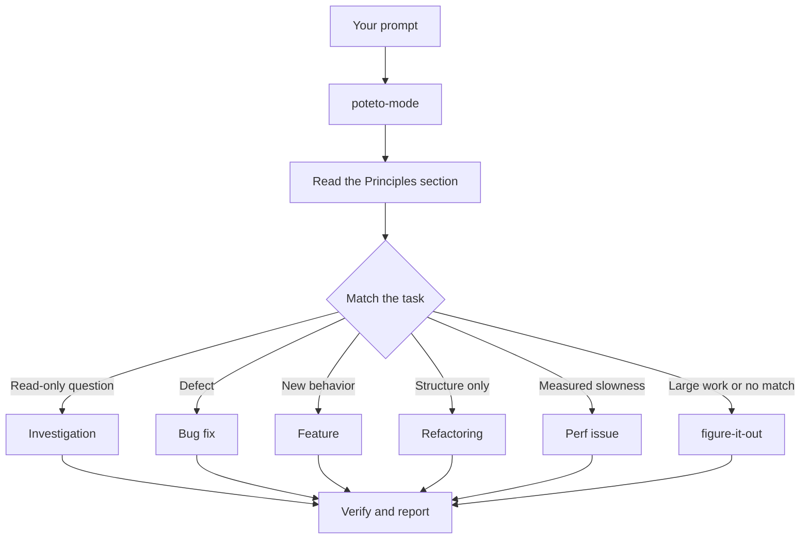

# `/poteto-mode` を通して作業をルーティングする

`/poteto-mode` は正面玄関です。ゴールを渡すと、22 のプレイブックのうち 1 つにマッチさせ、そのプレイブックのステップを todo リストにコピーし、ステップが必要とするときに他のスキルを呼び出します。このページでは、良いプロンプトがどのようなものか、そして実際にはどれほど短くてよいかを学びます。


## プロンプトに何が起こるか



図は代表的なルートを示しています。この他にも、メトリクスのヒルクライム、ランタイム症状やキャプチャ済みトレースの診断、プロトタイプ、ビジュアルパリティ、スキルのオーサリングと評価、自律実行、PR のオープン、PR やスタックをマージ可能状態まで見守る、検証済みスタックの出荷、PR キューやスタックを autopilot で実行、セッション引き継ぎ、安全な一時停止、マルチフェーズの計画、ワークツリー整理のためのプレイブックがあります。すべてのセットは [プレイブックディレクトリ](../../skills/poteto-mode/playbooks/) にあります。

## 儀式ではなくゴールを言う

仕様書を書く必要はありません。何が間違っているか、何をしたいかを言い、エージェントの時間を節約できる既知の情報を添えます。

```text
/poteto-mode users get two notifications after a retry. repro first, then fix and verify.
```

これは Bug fix 用のプロンプトです。「repro first」は礼儀ではなく本物の制約であり、プレイブックはそれを尊重します。todo リストが Bug fix のステップで埋まるのを見てください。

## プロンプトに入れるもの

役に立つプロンプトは最大 5 つの要素を持ち、それぞれ 1 文に収まります。

- **ゴール。** 何が間違っているか、何をしたいかを言います。
- **完了チェック。** 合否判定できる必要があります。「よくして」や「1 時間かけて」はチェックではありません。
- **見たい証拠。** 実際のコマンド出力、フローの動画、保存された値、ビフォーアフターの数値を要求します。
- **すでに知っていること。** 症状、再現手順、ログ行、リンクはエージェントの検索を節約します。
- **本物の制約。** 「repro first」「まだコードを変更しない」「挙動変更ゼロ」「進む前にレビューさせて」は、それぞれエージェントの動きを変えます。

5 つすべてを含む 1 つのプロンプトです。

```text
/poteto-mode the csv export drops its last row since yesterday's deploy. failing job id is 4812. repro first, then fix. done means the 60k-row fixture exports every row. show me the row counts before and after.
```

一方、入れない方がよいものが 2 つあります。

- **方法。** 達成すべきことを言い、あなたが選びそうな道より良い道をエージェントが見つける余地を残してください。スキルのリストも同様で、下記の落とし穴で扱います。
- **原因に対するあなたの仮説（最初は）。** 仮説を言うと、指差した方向に探索が狭まります。あなたの勘を共有する前に、エージェントに問題を自分の言葉で言い直させてください。

長いスレッドや曖昧なバグなど、ノイズの多い報告の場合は、言い直しを最初のステップにします。

```text
/poteto-mode read this thread. restate the underlying issue in your own words, in plain english. don't change any code yet.
```

誤読は言い直しに現れ、まだコードは存在しません。そこで直せば、間違った修正ではなくメッセージ 1 つで済みます。プレイブックなしで言い直しだけを行うには、[`/in-your-own-words`](../../skills/in-your-own-words/SKILL.md) を実行します。エージェントが考えるあなたのゴールと解決しようとしている問題を言い直します。

プロンプトの方向が正しいか不安なときは、送信前に [`/sharpen`](../../skills/sharpen/SKILL.md) を通してください。

```text
/sharpen write a migration guide for the v2 config format.
```

エージェントは、トッププロならあなたが頼まなかった何をするか、彼らが出発点とする最も生の素材、使う手法と道具、そしてあなたやエージェント以外の何が結果の正しさを示すかを述べます。その上で、あなたのプロンプトを書き直し、ちょうどそれを要求するものに、深くはするが大きくはしないでまとめます。書き直されたプロンプトは、実験で解決できる選択をプロトタイプで試し、観察から推奨を出すようエージェントに求めます。プロダクトや好みの選択はあなたに残します。タスクは実行しません。書き直しを読んでから、たとえば `/poteto-mode` で送信してください。

## フォローアップは短く

会話がすでにコンテキストを持っているときは、プロンプトはほぼ何もない状態に縮みます。次のどれでも十分です。

```text
/poteto-mode do it
```

```text
continue
```

```text
keep going until done
```

短くて済むのは、プレイブックが構造を保ち、Custom Mode が `/poteto-mode` を毎ターンのコンテキストに保つからです。開始方法は [pstack をセットアップする](./01-setup.md#run-your-first-task) にあります。あなたの言葉が意図を運び、スキルが厳密さを運びます。

## 「new task」でタスクを切り替える

長いチャットは直前のタスクからコンテキストを蓄積します。話題を変えるときはそう伝えてください。

```text
/poteto-mode new task. figure out why the cache entry survives logout. don't change any code yet.
```

「new task」は、前のプレイブックを続けるのではなく再マッチせよと `/poteto-mode` に伝えます。「don't change any code yet」は今回を Investigation に固定します。この 2 つのフレーズがないと、Feature の途中のモードはあなたの質問を次の Feature ステップとして扱いがちです。

## 並列作業にはそれぞれ専用のマシンを与える

1 つのコンピュータ上の 1 つのリポジトリに対して複数のエージェントを走らせると、ワーキングツリー、ポート、ビルド出力を奪い合います。最もきれいな分離は [cloud subagent](https://cursor.com/docs/subagents#cloud-subagents) です。各々が独自の VM とブランチを持つので、あなたのマシンに触れずに依存関係をインストールし、アプリを動かし、結果の動画を記録できます。タスクの前に `/in-cloud` と打つか、親チャットに cloud subagent へ作業を渡すよう頼んでください。

作業をローカルに置かざるを得ない場合は、最初にワークツリーを要求してください。

```text
/poteto-mode new task. branch off <base> in a fresh worktree, then port the parser change there.
```

各タスクを自分のブランチとワークツリーに置けば、エージェントが互いのファイルを踏みません。ワークツリーはディスクとマシンリソースを消費するので、ノートパソコンでは一度に少数しか動きません。[PR を開くプレイブック](../../skills/poteto-mode/playbooks/opening-a-pr.md) はコード変更のときすでにワークツリーから動くので、特定のベースや場所が重要な場合にのみこれを明示します。

ワークツリーは溜まります。ディスクが逼迫したら尋ねてください。

```text
/poteto-mode what's eating my disk? prune the worktrees that are safe to prune.
```

[ワークツリー整理プレイブック](../../skills/poteto-mode/playbooks/worktree-cleanup.md) は、マージ状態、未コミット作業、どのチャットがまだ触っているかで各ワークツリーを分類します。その証拠がクリアしたものだけを削除し、未コミット作業を持つものについてはあなたの判断を待ちます。

## 動かしたままにする

席を立つときは、完了の意味を言って去ってください。

```text
/poteto-mode im stepping away. keep going until the migration check reports zero old callers. log your decisions.
```

後からレビューする作業は [`/figure-it-out`](../../skills/figure-it-out/SKILL.md) 経由でルーティングされ、実行のフェーズを設計し、[`/show-me-your-work`](../../skills/show-me-your-work/SKILL.md) の決定ログを保ちます。完全なオーバーナイト契約は [寝ている間に作業を進める](./07-overnight.md) にあります。

**落とし穴:** プロンプトでスキルを列挙しないでください（「/architect を使い、次に /arena、それから /interrogate...」）。プレイブックがすでにシーケンスを組んでおり、手書きのシーケンスは通常プレイブックが保持するステップを並べ替えたり落としたりします。特定の選択を上書きしたいときだけスキル名を指定してください。

ルーティングルールの全容は [`poteto-mode`](../../skills/poteto-mode/SKILL.md) 自体を読んでください。

次は [コードを理解する](./03-understand.md) です。
