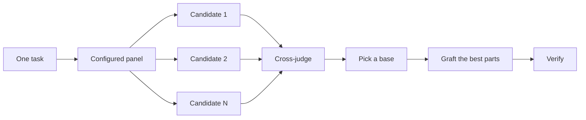

# コードを書く前に設計する

難しい設計を 1 回で終わらせると、モデルが最初に思いついた形で固まってしまいます。`/architect` は実装前に型と境界を定めます。`/arena` は同じブリーフに対して複数の試みを走らせ、その最良部分を統合します。`/interrogate` は他のモデルに結果を壊そうとさせます。設計の統合ではなくカバレッジが目的の場合、`/swarm` はスライスやレースをファンアウトして結果を集約します。

最も多い設計のミスは 2 つです。エージェントの最初の設計をそのまま採用すること、そしてコードでテストされていない計画を磨くことです。このページは両方を正します。コードを通して計画します。プロトタイプが未解決の問いに答え、README やチュートリアルが目標を設定し、書かれた計画は最後に来ます。


## `/architect` で形を定める

```text
/architect design the import pipeline before writing any code. i care most about how callers use it.
```

[`/architect`](../../skills/architect/SKILL.md) はまず、変更が触れるすべてのシステムをトレースします。次に、型、シグネチャ、モジュール境界を持つ 2 つの異なる形をスケッチし、各状態の所有者が 1 つ、各タスクのやり方が 1 つ、呼び出し側が知るべきことが最少になる方を選びます。大きな設計や意見の分かれる設計では、単独でスケッチする代わりに `/arena` を走らせます。コードの前に設計を見たいなら、プロンプトでそう言ってください。

設計はコードを書き始めても聖域ではありません。同じ回避策が繰り返し戻ってくるなら、`/architect` は回避するのではなく再設計します。

## `/arena` で試行をファンアウトする

```text
/arena take my prompt to the arena verbatim. i want to compare their proposals with yours.
```

[`/arena`](../../skills/arena/SKILL.md) は、その下にある汎用ツールです。N 個のサブエージェントが同じ設計またはコードブリーフを並行して試み、それぞれ独自のワークツリーまたはディレクトリに書き込みます。別ベンダーのモデルによる読み取り専用のジャッジが各候補をルーブリックに照らして採点します。別ベンダーのモデルが動かせないときは、コーディネータはジャッジをスキップしてベースを自分で選びます。コーディネータは各候補を端から端まで読み、ベースを選び、敗者から最良のアイデアを接ぎ木し、結果を検証します。



パネルは [`/setup-pstack`](../../skills/setup-pstack/SKILL.md) の設定から来ており、タスクごとに調整できます。決定が重要なときは候補を多く、そうでないときは少なく要求してください。

```text
/arena this, 5 candidates. the cache key format is expensive to change later.
```

## `/swarm` でスライスとレースをカバーする

```text
/swarm check every package under packages/ against its check.sh. one worker per package. one report.
```

[`/swarm`](../../skills/swarm/SKILL.md) は、独立したスライス、カバレッジマトリクス、ガントレットレーン、探索パーティション、または宣言済みの race arm に対して N 個のワーカーをファンアウトします。各ワーカーは独自のスコープとチェックを持ち、`PASS`、`ISSUES`、`BLOCKED` を返します。親はワーカーを待ち、ギャップや脱落者を含む 1 つのコンパクトなレポートを返します。

並列性がカバレッジを買えるときや、独立したチェックをレースさせたいときに手を伸ばします。`/arena` はすべてのワーカーに同じ設計またはコードブリーフを与え、その後ベースを選んで最良部分を接ぎ木します。`/swarm` はスライスをカバーするか、前もって宣言した選択ルールに従ってレースを実行します。ベース選択と接ぎ木の儀式は使いません。

## `/interrogate` で壊す

```text
/interrogate the whole branch, but skeptically. no nitpicks unless it's an actual bug or regression.
```

[`/interrogate`](../../skills/interrogate/SKILL.md) は、変更とその意図を構成済みモデルの adversary に渡し、それぞれが実コードに対して実行することで壊そうとします。adversary は異なる失敗を見つけます。コマンドを再実行して意図を壊す失敗が示されたときだけ、発見が残ります。レポートは各検証済みの発見と、それを見つけた adversary、そして各 adversary が何を落としたか、その理由を列挙し、何も適用しません。

Dropped リストも読んでください。判定を上書きできます。

## 議論ではなくプロトタイプする

最初の設計を決して採用しないでください。いくつかを要求し、見える証拠から選んでください。

```text
/poteto-mode prototype a few options for the new dropdown menu. take screenshots or videos for me to compare.
```

[Prototype プレイブック](../../skills/poteto-mode/playbooks/prototype.md) はスクラッチディレクトリに使い捨てのスケッチを作り、バリアントを 1 つのスイッチャの背後に置き、それぞれを動かし、スクリーンショットやタイミングをキャプチャします。UI だけでなく、挙動やアルゴリズムにも使えます。プロトタイプはコードによる計画です。エージェントはあなたに尋ねる代わりに何かを動かして自分の未解決の問いに答え、あなたが思いつかなかった選択肢の余地を残します。

同じ考えは本物の設計にもスケールします。`/architect` をプロトタイプと組み合わせ、レビューゲートを保ってください。

```text
/poteto-mode we need rate limiting for external webhooks. /architect it first, and answer open questions with prototypes. let me review before proceeding.
```

抽象的な計画に adversary を使わないでください。`/interrogate` は実行で証明できない発見をすべて落とすので、コードが背後にない計画では壊すべきものが少ないのです。プロトタイプに問いを解かせ、できあがったものをレビューしてください。

## 共有コードは README を先に書く

他のコードが使うパッケージや API では、ユーザーが読むドキュメントから始めてください。

```text
/poteto-mode write a tutorial for how i would use the new config package first. then /teach me why it beats the current one.
```

チュートリアルを先に書くと、呼び出し側の視点が強制されます。架空のユーザーに API を説明し、そこから実装に向かって作業します。ドキュメントは、エージェントが自身の作業をチェックする具体的な目標にもなります。ドキュメント自体が重要なときは [`/technical-writing`](../../skills/technical-writing/SKILL.md) を指名し、チュートリアルがリファレンスや解説に同時に漂流しないようにしてください。

## 設計が決まったら計画を書く

pstack には意図的に計画スキルがありません。書かれた計画が欲しいときは、設計が固まってから求めてください。

```text
/poteto-mode turn this design into a plan. small verifiable PRs, each with its own verification steps.
```

[Multi-phase plan プレイブック](../../skills/poteto-mode/playbooks/multi-phase-plan.md) は残っている未解決の問いをプロトタイプで解決し、PR ごとに 1 セクションを書き、各セクションを変更が機能する証明で締めくくります。パスするテストスイートだけでは証明として足りません。計画が成果物です。プレイブックは実装せず、あなたがゴーと言ったときだけ実行が始まります。

移行の場合、バーをプロンプトで明示してください。

```text
/poteto-mode plan the migration of our ui library to the new styling system. small verifiable PRs, each with visual regression checks. the result must match the original exactly, bugs included.
```

「bugs included」は、移行の途中で密かに修正することを防ぎます。それをすると古い出力と新しい出力を比較できなくなります。何日にもわたるプロジェクトでは、他のエージェントが進行中の作業を見られるよう、しばらくの間計画をリポジトリにコミットできます。作業がランディングしたら削除してください。

## どれくらいの設計作業がそのタスクに値するか

すべての変更にこれが必要なのか気になるかもしれません。いいえ。ほとんどの変更には何も必要ありません。おおよそのはしごはこうです。

- 自信のない小さく完成した変更には `/interrogate` 単独で。
- 関数境界を越えたり所有権を動かしたりする変更には `/architect`。設計が大きい、または意見が分かれるときは `/arena` を伴います。
- 命名、フォーマット、アルゴリズムなど、独立した試行が役立つ独立した決定には、直接 `/arena`。
- カバレッジマトリクス、並列チェックのセット、宣言済み arm のレースには `/swarm`。
- レイアウト、タイミング、アプローチなど、何かを動かせば答えられる未解決の問いには、議論ではなくプロトタイプ。
- 逆転にコストがかかる意見の分かれる設計には `/architect`、出荷前に `/interrogate`。
- 複数の PR にまたがる作業には、設計が固まってから書かれた計画。

`/poteto-mode` はすでにこのはしごを適用します。境界を越える作業は `/architect` を単独で起動するので、デフォルトより厳しく、または緩く精査したいときにだけ直接これらを呼び出します。

次は [変更を作り、差分をきれいにする](./05-build-and-clean.md) です。
