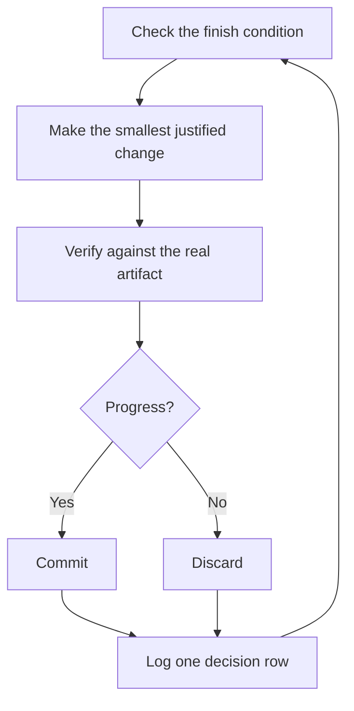

# 寝ている間に作業を進める

これはそれ以前のすべての報酬です。自分の仕事を検証できると信頼できるエージェントは、難しいタスクを任せて放置できるエージェントです。それを安全にするのは希望ではありません。チェック可能な完了条件、隔離されたワークツリーまたはクラウドエージェント、そして朝に監査する決定ログです。


## ループを回す前に信頼を獲得する

信頼しないループは未チェックの作業を速く生むだけで、反復のたびに混乱が複利で増えます。放置する前に、ループがそれを獲得しているか確認してください。

- そのタスクを自分で 1 度やったか、エージェントがやるのを見たことがある。良いとはどういうものか知っている。
- エージェントはあなたが自分で使う道具と信号を持っている。検証スキル、プロファイラ、ログです。
- 各ステージは作業を証明し、作業がバーを下回ったときにラインを止められる。
- トランスクリプトをいくつか読み、繰り返される失敗を道具、スキル、チェックに変えた。

4 つすべてが成立したときだけループを自律にしてください。それまでは、見ながら回してください。

## オーバーナイト契約

良いハンドオフはゴール、完了条件、権限、脱出口を持ちます。長い必要はありません。

```text
/poteto-mode im going to bed. migrate every caller to the new parser in a fresh worktree off <base>.
done means zero old callers, all parser fixtures pass, old api deleted.
keep a decision log. don't ask me before committing.
/loop until done. if you're truly stuck after a few hours, stop and write up why.
```

各行があなたに何をもたらすかを辿りましょう。

- 「im going to bed」はセッションの上書きです。エージェントは尋ねるのをやめ、進み続けます。
- 「done means...」はゴールを、各反復が実行できるチェックに変えます。
- 「fresh worktree off `<base>`」は、あなたが開いている他のものと衝突しないようにします。
- 「don't ask me before committing」は、エージェントがさもなくばブロックする権限を前もって答えます。
- `/loop` は Cursor の組み込みウェイクメカニズムで、pstack のスキルではありません。[Autonomous run プレイブック](../../skills/poteto-mode/playbooks/autonomous-run.md) は、イベントやハートビートで完了条件を再チェックするのにこれを使います。
- 脱出口は、本物の袋小路で止まって理由を書けるようにします。8 時間のクリエイティブなゴール再解釈よりはましです。

席を立った後にこの作業をレビューするので、`/poteto-mode` は [`/figure-it-out`](../../skills/figure-it-out/SKILL.md) 経由にルーティングします。これはコードの前に実行のフェーズを設計し、決定ログを配線します。

実行を意図的に止めるには、エージェントに一時停止するよう、またはあなたがオフラインになる、Cursor を再起動すると告げてください。[Pause safely プレイブック](../../skills/poteto-mode/playbooks/pause-safely.md) は現在のステップを完了または退避し、work-in-progress のチェックポイントをコミットし、再開ノートを書きます。新鮮なチャットが Session pickup プレイブック経由でそのノートから作業を拾い上げます。「keep going」と言っても一時停止は起こりません。

## ループは一晩中何をしているか



1 つの変更、1 つのチェック、1 つのログ行を反復ごとに行います。役に立たなかった変更は捨てられ、乗せられたままにはなりません。停滞は停止ではなく方針転換を意味し、勝利を宣言するために完了条件が密かに緩むことはありません。

## 朝の監査

[`/show-me-your-work`](../../skills/show-me-your-work/SKILL.md) が実行をレビュー可能にしています。各行は時刻、フェーズ、決定、理由、証拠へのポインタ、結果を `decisions.tsv`（複数の実行が同じディレクトリを共有するときは `.audit/<task-slug>.tsv`）の TSV に記録します。デフォルトはローカルに留まります。レビュアが結果を信頼するためにトレイルを必要とするほど野心的な作業のときにコミットしてください。

戻ったら、実行をレビュー形式で求めてください。

```text
/show-me-your-work catch me up on what you did last night
```

スキルが要約を返す前に、別のモデルファミリーのレビュアを起動してトレイルとトランスクリプトを読ませ、返信は精査に値するものを列挙する Attention セクションで終わります。まずそのセクションを読み、それが指すログ行を読んでください。あなたは決定を監査しているのであって、一晩を読み直しているのではありません。

監査ではなく手早いステータスが欲しいときは、作業を動かしたチャットで [`/ketchup`](../../skills/ketchup/SKILL.md) を実行してください。読むだけで、前回のあなたのメッセージ以降に何が変わったかを平易な言葉で、作業が生み出したスクリーンショットと小さな図とともに伝えます。それからマージ、承認、選択肢の判断など、あなた待ちの各案件を、推奨、証拠、リスクとともに列挙するので、返信だけから決定できます。

## 一晩がタスクではなくキューを保持するとき

上の契約は 1 つのタスクを 1 つの完了条件まで駆動します。独立した変更のキューや全プログラムを保持する夜もあります。2 つのプレイブックと 1 つのスキルが、同じ信頼をスケールアップします。

[Autopilot-full](../../skills/poteto-mode/playbooks/autopilot-full.md) は独立した PR のキューをマージまで動かします。各 PR はビルドからマージまで持ち運ぶ 1 人のオーナーエージェントを得て、オーナーは自身の判定でマージしません。新鮮な verifier の swarm がオーナーのコード完成版を確認します。後のリベースや小さな修正は 1 人の新鮮な verifier を得て、新しい挙動や大きな新差分だけがフル swarm を再度呼びます。マージするパッチでクリーンな判定が出たときだけマージが承認されます。

```text
/poteto-mode full autopilot on this queue. each item is independent. i want them merged by morning.
```

[Autopilot-stack](../../skills/poteto-mode/playbooks/autopilot-stack.md) はマージを除いた Autopilot-full です。検証済みの PR で朝を迎え、判定付きで、あなたがレビューしてランディングさせます。PR は依拠する PR の上にのみ積みます。何かがマージされる前に自分の目で作業を見たいときは、Autopilot-full よりこちらを選んでください。

```text
/poteto-mode autopilot these five changes, but don't merge. i'll land them in the morning.
```

多数のパッケージをまたぐ移行などの全プログラムには、独自のプレイブックはありません。`/poteto-mode` は大規模または横断的な作業を [`/figure-it-out`](../../skills/figure-it-out/SKILL.md) にルーティングし、1 つの厳密な実行を設計させます。

```text
/poteto-mode migrate every package to the new store. own it until each one is converted and merged. i'll check in twice a day.
```

## 多くのプロジェクトを並列に動かす

[Cursor Project](https://cursor.com/blog/projects) は 1 人のコーディネータエージェントに永続的なスレッドを与えます。コーディネータはコードを書きません。サブエージェントを指揮します。デフォルトでクラウドで動くので、ノートパソコンを閉じても作業は続きます。コーディネータへのプロンプトを `/poteto-mode` で始めると、生成されるサブエージェントはプレイブックに従います。起動する各エージェントはまず [`worker.md`](../../skills/poteto-mode/worker.md) を読むので、ワーカーはキックオフのバーを保ち、あなたに尋ねずに可逆的な判断を下し、レビュー準備完了の PR を開きます。

役立つ習慣がいくつかあります。

- 機能、移行、パフォーマンス推進、技術的負債のクリーンアップなど、作業の塊ごとに Project を与えてください。複数が並列で走れます。
- 関連するチャット、終わったものも含めて、Project にドラッグしてください。それらは Project 内の全エージェントのコンテキストになります。
- 各 PR にマージ前の verifier swarm を与え、Autopilot-stack または Autopilot-full にキューを運ばせてください。
- データに裏付けられた計画をコーディネータに求め、尋ねる前に未解決の問いをプロトタイプで答えさせてください。

1 つのプロンプトが、研究から実行まで Project 全体を運べます。

```text
/poteto-mode refactor this repo so its architecture is more agent friendly. use /correct and /architect on past commits and review comments to find the mistakes agents make most here. use /recall for context from past chats. answer open questions with prototypes instead of asking me. come back with a plan backed by real data. once i approve it, run it with autopilot-stack or autopilot-full, and ask me which.
```

## ループに自ら開始させる

上のループはすべて、あなたが開始するのを待っています。スケジュールまたはイベント駆動の自動化がそのステップを取り除きます。ソフトウェア保守はこれに向くステージに分かれます。報告をトリアージし、再現し、修正し、修正を検証する。そんなラインを信頼可能にする 2 つのルールがあります。

- 各ステージはラインを止められる。トリアージは報告が期待通りの挙動だと判断でき、repro は再現に失敗でき、fixer は変更がリスクが高すぎると判断できる。それらの結果はどれも有用で、悪い作業が次のステージに届くのを防ぎ、そこで undo のコストが高くなるのを避けます。
- 各ステージは証拠を引き渡す。repro は壊れた状態のスクリーンショットと動画を添付し、修正はビフォーアフターの証明を添付する。そうすれば、人間はコードを 1 行読む前に、エージェントが正しいものを修正したかをチェックできます。

pstack は Slack イシュー報告用の休眠中の [自動化パック](../../automations/benny/README.md) としてこれを同梱しています。1 つの自動化が各報告をトリアージします。もう 1 つは確認されたバグを再現し、小さな draft fix を準備することがあります。その [`FOR_AGENTS.md`](../../automations/benny/FOR_AGENTS.md) にエージェントを向けて、対象リポジトリを命名してセットアップしてください。

**落とし穴:** 時間は完了条件ではありません。「これに 4 時間取り組んで」はエージェントにチェックすべきものを与えず、結果ではなく 4 時間の動きで目を覚ますことになります。`/loop` には合否判定できる述語を与えてください。

次は [原則の名前で舵を取る](./08-principles.md) です。
